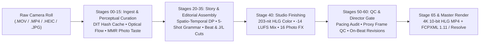

# `video_editing_ai` — 21-Agent AI Post-Production Studio

**Turn raw, unscripted camera rolls into cohesive 4K 10-bit HLG HDR films and editable DaVinci Resolve / Final Cut Pro timelines.**

`video_editing_ai` is an open-source, multi-agent post-production pipeline for family travel films, museum/cultural documentaries, and day-in-the-life vlogs. Point it at a folder of raw `.MOV`/`.MP4` clips and `.HEIC`/`.JPG` photo bursts, describe the story you want, and 21 specialized editing agents collaborate over a typed blackboard (`PipelineBlackboard`) to cull, structure, cut, color-grade, mix, QC, and master your film.

---

## Why `video_editing_ai` Exists (Value Proposition)

Raw vacation and event folders suffer from a **10:1 signal-to-noise problem**: shaky camera drops, 12-shot photo bursts where someone blinked, multi-camera clock drift, wind-clipped audio, and mixed 8-bit SDR stills beside 10-bit HDR iPhone/mirrorless footage.

- **Hours of Culling Reduced to Minutes — Without Losing Candid Soul**: Extracts multiple distinct spoken quotes and scenic peaks from long takes (`1 -> N` subclip splitting), strips logistical camera-operator chatter (*"wait, is it recording?"*), and rejects blinked or motion-blurred burst photos while preserving intentional portrait bokeh.
- **Real Film Grammar Instead of Cookie-Cutter Templates**: Organizes chapters around real spatio-temporal, GPS, and semantic scene shifts rather than arbitrary time slices, then sequences shots inside each chapter using documentary **Five-Shot Grammar** (*Establishing Wide -> Spoken A-Roll -> Semantic Track V2 Cutaway -> Scale-Alternating Weave -> Resolving Button*).
- **True 10-bit HLG HDR & Broadcast Audio Finishing**: Maps 8-bit sRGB photos and graphics to ~203-nit HLG diffuse white (~75% signal) so titles and borders never sear on HDR displays, levels quiet voices against loud camera operators toward `-14 LUFS`, and deeply mutes BGM (`<= -28 dB`) during live diegetic performances.
- **Zero Lock-In — Glass-Box Artifacts & Native NLE Handoff**: Every stage emits human-readable JSON/YAML contracts (`media_index.json`, `paper_edit.json`, `timeline.yaml`) plus frame-accurate **FCPXML 1.11 (`timeline.fcpxml`)**, CMX3600 EDL, and OpenTimelineIO for instant fine-tuning in DaVinci Resolve or Final Cut Pro.
- **Offline-First with Optional Multimodal VLM Escalation**: Runs 100% locally out of the box (`faster-whisper`, OpenCV optical flow & portrait perception, `all-MiniLM-L6-v2` neural embeddings, FFmpeg) and optionally escalates creative vision/story decisions to **Google Antigravity**, **Gemini Vision**, **OpenAI Vision**, or **Anthropic Claude Vision**.

---

## How We Achieve It



### 1. Perceptual Video & Photo Intelligence (Stages `05–15`)
- **Deterministic DIT Ingest (`dit_ingest`)**: Normalizes multi-camera EXIF/QuickTime clock drift, probes BT.2020 HLG / Log / sRGB color tags and audio LUFS/SNR, and caches technical metadata by file hash + mtime.
- **Optical-Flow & Prosody Multi-Moment Video Culling (`culler`)**: Decodes low-res proxy streams to measure dense Farneback optical-flow velocity, pan coherence, and camera-drop jerk—trimming corrupted head/tail shake into clean `[usable_in, usable_out]` handles, filtering operator filler speech, and splitting long clips into separate spoken `a_roll` and scenic `b_roll` golden windows.
- **Human-Aware Graph Burst Dedup & Submodular MMR (`photo_curator`, `cast_tracker`)**: Clusters adjacent and non-adjacent zoom/crop duplicates via 64-bit `dHash` + multi-scale Lab/edge pyramids, penalizes closed eyes (`eye_open_score`) while rewarding smiles and subject-sharp bokeh, optimizes portfolio variety via **Maximum Marginal Relevance (MMR)**, and pairs vertical diptychs by **CIE-Lab chromatic harmony**.

### 2. Dramaturgical Storyline Engine (Stages `20–35`)
- **Multi-Mode Chapter Architecture (`story_producer`)**: Partitions selects via Dynamic Programming across time gaps, Haversine GPS shifts (`>= 250m`), lighting transitions, and neural semantic similarity (`sentence-transformers/all-MiniLM-L6-v2`). Supports four narrative modes (`--story-arc-mode`):
  - `chronological_cinema` *(default)*: Real-world journey order with Five-Shot intra-chapter film grammar.
  - `hero_journey`: 5-stage dramatic arc (*Threshold -> Discovery -> Wonder -> Intimate Reflection -> Finale*).
  - `thematic_essay`: Groups footage into semantic concept acts regardless of capture timestamp.
  - `high_energy_reel`: Front-loads curiosity-scored kinetic peaks synced to musical beat drops.
- **Semantic Cutaways & Elastic Assembly (`dialogue_editor`, `montage_editor`, `lead_editor`)**: Matches spoken A-roll topics to Track `V2` B-roll cutaways via neural cosine similarity, snaps montage cuts to `beat_grid.json` downbeats, biases Ken Burns trajectories toward detected face bounding boxes, and stitches chapters with `-0.35s` J/L-cut audio bridges and continuous BGM.

### 3. 10-bit HLG Finishing, Closed-Loop QC & Beat-Safe Revisions (Stages `40–65`)
- **16 Bespoke Photo Projection Modes + HDR Color & Re-Recording Mix**: Combines 2.5D parallax, museum vitrines, split-diopter plates, darkroom contact-sheet push-ins, and bilingual typography (`title_designer`) with per-clip SDR-to-HLG color management (`hdr_colorist`) and EBU R128 dialogue/diegetic-music mixing (`sound_mixer`).
- **Rendered Proxy Watchdown & On-Grid Revisions (`showrunner`, `visual_qc`, `production_director`)**: Audits creative-brief compliance and boundary proxy frames for black flashes, clipped highlights, or title collisions. When fixes are needed, Stage 50/60 emits chapter-scoped `RevisionDirective` items back to Stage 30/35 editors (up to `max_revisions = 2`) so montage cuts **never** drift off the musical beat grid.

---

## Modular 21-Agent Architecture (Stages 00 -> 65)

Every specialist role is registered via `@register_agent` in `AgentRegistry` and communicates through strict Pydantic contracts on `PipelineBlackboard` (`blackboard.json`). Run `python -m video_editing_ai.cli docs-sync` to keep this table and `.agent/skills/ai-video-editor/` synchronized with the codebase:

<!-- AGENT_REGISTRY_TABLE_START -->
| Stage | Role ID | Sub-Agent Class | Default | Requires -> Produces | Responsibilities |
| :--- | :--- | :--- | :--- | :--- | :--- |
| **Stage 00** | `client_intake` | `ClientIntakeAgent` | Core (`True`) | *(root)* -> `creative_brief.json` | Interviews the client on story arc, tone, must-haves, and pacing to produce creative_brief.json. |
| **Stage 05** | `dit_ingest` | `DITIngestAgent` | Core (`True`) | `creative_brief.json` -> `dit_manifest.json` | Deterministic Digital Imaging Technician (DIT) ingest specialist that performs recursive media discovery, caches technical FFprobe/EXIF metadata by file hash + mtime, normalizes multi-camera DateTimeOriginal clock drift, and probes HDR/SDR color spaces and audio LUFS/SNR. |
| **Stage 05** | `music_supervisor` | `MusicSupervisorAgent` | Core (`True`) | `creative_brief.json` -> `bgm_selection.json` | Analyzes destination, story tone, and creative brief to find, download, and EBU-R128 master mood-matched royalty-free background music across the full video duration, producing bgm_selection.json. |
| **Stage 10** | `culler` | `CullerAgent` | Core (`True`) | `creative_brief.json`, `dit_manifest.json` -> `media_index.json`, `annotations.yaml` | Consumes cached DIT ingest metadata, runs Whisper ASR, optical-flow camera stability & prosody peak analysis, filters operator filler chatter, splits multi-moment videos into golden windows with elastic usable_in/usable_out handles, and scores selects in media_index.json. |
| **Stage 10** | `audio_vibe` | `AudioVibeAgent` | Core (`True`) | `creative_brief.json`, `bgm_selection.json` -> `beat_grid.json` | Analyzes selected background music strictly for BPM, beat/downbeat grid, and musical energy sections (intro, verse, chorus_drop, outro) into beat_grid.json (delegating audio mixing to Stage 40 sound_mixer). |
| **Stage 15** | `photo_curator` | `PhotoCuratorAgent` | Core (`True`) | `creative_brief.json`, `media_index.json` -> `photo_curation.json` | Evaluates photos with human portrait perception (open-eye blink rejection, smile boost, subject-vs-bokeh sharpness), non-adjacent zoom-tolerant graph burst clustering, Submodular MMR diversity optimization, and CIE-Lab chromatic diptych pairing. |
| **Stage 15** | `cast_tracker` | `CastContinuityAgent` | Core (`True`) | `media_index.json` -> `cast_manifest.json` | Groups recurring family/cast speakers and faces across clips, tags spoken language per utterance (Mandarin vs. English from faster-whisper segments), and records normalized subject/face bounding boxes (x1, y1, x2, y2) in cast_manifest.json for face-safe Ken Burns framing. |
| **Stage 20** | `story_producer` | `StoryProducerAgent` | Core (`True`) | `creative_brief.json`, `media_index.json` -> `paper_edit.json` | Clusters culled selects into 2-8 chapters via spatio-temporal, GPS, and neural semantic boundaries, supports chronological_cinema, hero_journey, thematic_essay, and high_energy_reel story modes, pairs Track V2 cutaways via semantic similarity, sequences chapters with Five-Shot film grammar, and curates a non-duplicating 00:00-00:06 cold_open_hook in paper_edit.json. |
| **Stage 25** | `narrator_voiceover` | `NarratorVoiceoverAgent` | Core (`True`) | `creative_brief.json`, `paper_edit.json` -> `narration_script.json` | Big-budget documentary scriptwriter and voiceover producer that writes brief, evocative narration cues at chapter openings and finales (never colliding with live camera speech) and synthesizes broadcast voiceover audio tracks. |
| **Stage 30** | `dialogue_editor` | `DialogueEditorAgent` | Core (`True`) | `paper_edit.json`, `media_index.json` -> `dialogue_selects.json` | Trims A-roll clips on word timestamps within usable_in/usable_out handles, sets -0.35s J-cut audio lead-ins, populates bilingual subtitles, and places Track V2 B-roll cutaways over spoken takes. |
| **Stage 30** | `montage_editor` | `MontageEditorAgent` | Core (`True`) | `paper_edit.json`, `beat_grid.json`, `media_index.json` -> `timeline.yaml` | Snaps B-roll and photo durations to beat_grid.json beats/downbeats, biases Ken Burns framing toward CastContinuityAgent subject bboxes, supports hybrid candid-reaction chapters, and executes chapter-scoped beat-preserving revisions. |
| **Stage 32** | `camera_operator` | `CameraOperatorAgent` | Core (`True`) | `media_index.json`, `paper_edit.json`, `timeline.yaml` -> `cinematography_report.json` | Big-budget camera operator and reframing specialist that pairs vertical 9:16 video clips with complementary vertical photos into Live Video+Photo Diptychs and applies optical stabilization to handheld walking B-roll. |
| **Stage 35** | `lead_editor` | `LeadAssemblyEditorAgent` | Core (`True`) | `paper_edit.json`, `media_index.json`, `beat_grid.json`, `timeline.yaml` -> `assembly_report.json`, `timeline.yaml` | Stitches chapter timelines into one continuous EditTimeline, inserts 0.35-0.75s J/L-cut audio bridges across chapter transitions, keeps Track A3 BGM continuous across chapters, and clamps V1/V2 trims within usable_in/usable_out handles. |
| **Stage 40** | `title_designer` *(alias: `motion_graphics`)* | `MotionGraphicsTitleAgent` | Core (`True`) | `creative_brief.json`, `paper_edit.json`, `timeline.yaml` -> `graphics_manifest.json`, `motion_graphics_plan.json` | Consolidates all Track V3 graphics (opening card, chapter lower-thirds, GPS route progression cards, dialogue quote badges, optional EXIF stamps, and closing card), configures bilingual subtitles (PingFang SC / Avenir Next / platform fallbacks), and clamps RGBA peak white to HDR-safe diffuse white. |
| **Stage 40** | `vfx_designer` | `VFXAgent` | Core (`True`) | `paper_edit.json`, `beat_grid.json`, `timeline.yaml` -> `vfx_manifest.json` | AI-guided Stage-40 specialist that adds warm golden glow, subtle portrait vignettes, and beat-drop contrast pops to timeline.effects_track and writes vfx_manifest.json. |
| **Stage 40** | `hdr_colorist` *(alias: `colorist`)* | `HDRColoristAgent` | Core (`True`) | `media_index.json`, `paper_edit.json`, `timeline.yaml` -> `color_transform_manifest.json`, `color_grade_plan.json` | Inspects per-clip color tags (10-bit BT.2020 HLG vs. Camera Log vs. 8-bit BT.709/sRGB stills) from media_index.json, maps SDR clips & stills to ~203-nit HLG diffuse white (~75% HLG signal), and writes color_transform_manifest.json. |
| **Stage 40** | `sound_mixer` *(alias: `sound_designer`)* | `SoundDesignerMixerAgent` | Core (`True`) | `media_index.json`, `paper_edit.json`, `beat_grid.json`, `timeline.yaml` -> `audio_mix_manifest.json`, `sound_design_plan.json` | Post-assembly re-recording mixer that normalizes dialogue clips toward -14 LUFS, generates frame-accurate BGM ducking (-14 dB under speech, -20 dB Nat-Sound under pure B-roll, and <=-28 dB deep muting during has_diegetic_music clips), applies 0.33s audio crossfades, and synthesizes spatial foley/ambience stems. |
| **Stage 50** | `showrunner` | `ShowrunnerAgent` | Core (`True`) | `creative_brief.json`, `paper_edit.json`, `timeline.yaml` -> `pacing_audit.json`, `timeline.yaml`, `storyboard.md` | Deterministic compliance and pacing validator that verifies creative_brief.json must-haves, flags >3 consecutive static stills, flags pure B-roll >4.5s, checks timeline gaps/overlaps, and emits chapter-scoped RevisionDirectives without mutating montage cuts off the beat grid. |
| **Stage 55** | `visual_qc` | `ProxyWatchdownQCAgent` | Core (`True`) | `pacing_audit.json`, `timeline.yaml` -> `visual_qc_report.json` | Runs between Stage 50 (showrunner) and Stage 60 (production_director), sampling low-resolution boundary frames around cuts and Track V3 overlays to detect black flashes, frozen tail frames, subtitle/lower-third bounding-box overlaps, clipped luminance blocks, and uncrossfaded audio cut spikes. |
| **Stage 60** | `production_director` | `ProductionDirectorAgent` | Core (`True`) | `creative_brief.json`, `paper_edit.json`, `pacing_audit.json`, `visual_qc_report.json`, `timeline.yaml` -> `director_review.json`, `timeline.yaml`, `storyboard.md` | Sole creative sign-off gatekeeper evaluating pacing_audit.json and visual_qc_report.json against the 6-dimension cinematic rubric, issuing beat-preserving chapter-scoped RevisionDirectives when needed, and writing director_review.json. |
| **Stage 65** | `nle_exporter` | `NLEExportAgent` | Core (`True`) | `timeline.yaml` -> `timeline.fcpxml` | Emits a frame-accurate timeline.fcpxml (FCPXML 1.11 for DaVinci Resolve & Final Cut Pro) mapping Track V1 spine, V2 connected B-roll cutaways, V3 title lanes, A1-A3 audio lanes, and chapter markers alongside EDL, OTIO, SRT, and ASS sidecars. |
<!-- AGENT_REGISTRY_TABLE_END -->

---

## Quickstart

### 1. Installation

```bash
# macOS (Apple Silicon or Intel/AMD Radeon Pro)
brew install ffmpeg libheif python@3.12
python3.12 -m venv .venv && source .venv/bin/activate
pip install --upgrade pip && pip install -e .
```

```powershell
# Windows (PowerShell, Python 3.12 + FFmpeg on PATH)
python -m venv .venv
.\.venv\Scripts\Activate.ps1
pip install --upgrade pip
pip install -e .
```

### 2. Run the 21-Agent Pipeline from the CLI

```powershell
# Inspect all 21 registered agents and their artifact contracts
python -m video_editing_ai.cli agents-list

# Run end-to-end: Ingest -> Curation -> Story -> Assembly -> Color/Mix -> QC -> FCPXML + 4K HLG MP4
python -m video_editing_ai.cli agents-run "<path_to_raw_media>" `
  -o ".\family_trip_project" `
  --bgm "<optional_path_to_bgm.mp3>" `
  --story-arc-mode chronological_cinema `
  -p "Create an upbeat 4-act family travel film. Preserve candid Mandarin and English dialogue with semantic B-roll cutaways, pair vertical portraits into harmonious diptychs, and include the evening live performance." `
  --export-fcpxml `
  --render

# Export FCPXML 1.11 (DaVinci Resolve / Final Cut Pro) from any existing project folder
python -m video_editing_ai.cli export-fcpxml ".\family_trip_project"
```

### 3. Launch the Interactive Local Web Studio

```powershell
python -m video_editing_ai.cli serve --port 8000
```

Open `http://127.0.0.1:8000` to run the **Stage 0 Client Intake Interview**, preview 16 photo projection effects, inspect live agent reasoning and `blackboard.json` messages, edit `timeline.yaml`, and trigger hardware-accelerated 4K HDR renders.

### 4. Optional Multimodal VLM Escalation

Out of the box, the pipeline runs 100% locally. To enable cloud VLM visual critique, semantic B-roll captioning, and dramaturgical refinement, set any supported provider key:

```powershell
# Choose auto (default), gemini, openai, anthropic, or antigravity
$env:AI_EDITOR_VLM_PROVIDER = "auto"
$env:GEMINI_API_KEY = "<your_key>"      # or OPENAI_API_KEY / ANTHROPIC_API_KEY
```

---

## Extending the Studio (`@register_agent`)

Add custom specialist roles without touching the core orchestrator, then run `python -m video_editing_ai.cli docs-sync` to auto-generate skill playbooks and update documentation tables:

```python
from video_editing_ai.agents import BaseEditingAgent, PipelineBlackboard, register_agent

@register_agent
class CustomAtmosphereFXAgent(BaseEditingAgent):
    role_id = "custom_atmosphere_fx"
    display_name = "4x. Custom Atmosphere FX"
    stage_order = 40  # Executes in Stage 40 between Lead Assembly (35) and Showrunner (50)
    enabled_by_default = False
    requires_artifacts = ["timeline.yaml"]
    produces_artifacts = ["custom_fx_manifest.json"]
    skill_reference_file = "99_custom_atmosphere_fx.md"

    def run(self, blackboard: PipelineBlackboard) -> dict:
        path = blackboard.set_custom_artifact("custom_fx_manifest.json", {"preset": "Halation_Soft"})
        blackboard.send_message(self.role_id, "showrunner", "Applied custom FX pass", {"path": str(path)})
        return {"fx_manifest": str(path)}
```

---

## Antigravity Skill Package

This repository ships a ready-to-use Antigravity Skill at `.agent/skills/ai-video-editor/SKILL.md` with progressive-disclosure reference playbooks in `.agent/skills/ai-video-editor/references/`:
<!-- AGENT_REF_LIST_START -->
- `00_client_intake_agent.md`
- `01a_dit_ingest_agent.md`
- `08_music_supervisor_agent.md`
- `01_culler_agent.md`
- `04_audio_vibe_agent.md`
- `09_photo_curator_agent.md`
- `15_cast_tracker_agent.md`
- `02_story_producer_agent.md`
- `10_narrator_voiceover_agent.md`
- `03_picture_editors.md`
- `11_camera_operator_agent.md`
- `16_lead_editor_agent.md`
- `12_motion_graphics_agent.md`
- `06_vfx_agent.md`
- `13_colorist_agent.md`
- `14_sound_designer_agent.md`
- `05_showrunner_agent.md`
- `17_visual_qc_agent.md`
- `07_production_director_agent.md`
- `18_nle_exporter_agent.md`
- `10_contracts_and_rendering.md`
<!-- AGENT_REF_LIST_END -->

---

## Cross-Platform Hardware Encoding Support

| Platform / GPU | 10-bit 4K HLG HDR Encoder | 8-bit SDR Encoder | Highlights |
| :--- | :--- | :--- | :--- |
| **macOS (Apple Silicon & Intel/AMD Radeon Pro)** | `hevc_videotoolbox` (`main10`, `p010le`) | `h264_videotoolbox` | Auto-detects `zscale` vs. calibrated BT.2020 HLG fallback; native system CJK/editorial typography |
| **Windows (NVIDIA GeForce RTX)** | `hevc_nvenc` (`p4`, `main10`, `p010le`) | `h264_nvenc` | 5-worker parallel segment rendering + NVENC hardware encode |
| **Windows (AMD Radeon / Intel Arc & iGPU)** | `hevc_amf` / `hevc_qsv` (`p010le`) | `h264_amf` / `h264_qsv` | Native AMF and QuickSync hardware acceleration |
| **Linux / CPU Fallback** | `libx265` (`yuv420p10le`) | `libx264` (`yuv420p`) | Deterministic multi-threaded software fallback |
