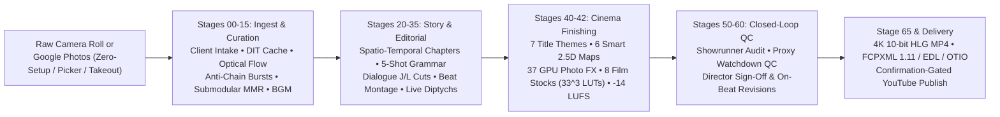

# `video_editing_ai` — 22-Agent AI Film & Post-Production Studio

**Turn raw, unscripted camera rolls — or Google Photos trips — into cohesive 4K 10-bit HLG HDR films and editable DaVinci Resolve / Final Cut Pro timelines.**

`video_editing_ai` is an open-source, GPU-accelerated multi-agent post-production studio built for **family travel films, museum & cultural documentaries, and unscripted day-in-the-life vlogs**. Point it at a local folder of `.MP4`/`.MOV`/`.JPG`/`.HEIC` files (or directly at **Google Photos** with zero cloud API setup), describe the story you want, and **22 specialized editing agents** collaborate over a typed Pydantic blackboard (`PipelineBlackboard`) to ingest, cull, structure, cut, animate, color-grade, mix, visually QC, and master your film.

---

## Why `video_editing_ai`

Raw trip folders suffer from a **10:1 signal-to-noise problem**: shaky camera drops, 10-shot bursts where someone blinked, dizzying handheld whip-pans, multi-camera clock drift, mixed 33MP full-frame stills beside 10-bit HDR phone videos, and hours of tedious timeline assembly.

- **Built for Antigravity-First Creative Direction (Zero Lock-In)**: Mechanical work (EXIF/FFprobe caching, optical-flow scoring, contact-sheet grids, GPU rendering, ripple timecode shifts, LUFS ducking) runs deterministically in Python/FFmpeg/CUDA/MPS; creative work (visual contact-sheet critique, cold-open hook selection, museum plaques, color direction, pacing revisions) is driven conversationally inside **Google Antigravity** via `AGENTS.md` and the `ai-video-editor` Skill — with full standalone CLI, Web Studio, and local offline fallbacks.
- **Zero-Setup, High-Recall Google Photos Ingestion**: Pull trips directly from `photos.google.com` without configuring Google Cloud OAuth, preserving **100% original EXIF GPS & QuickTime locations** for 2.5D Travel Maps. Uses Photo Stacks, Day-Header / `Shift+Click` batching, **Seed-Anchored Anti-Chaining Burst Clustering**, **Dual-Camera Smartphone-to-Camera GPS Inheritance**, **Event-Clustered Submodular MMR (`1.6×` recall headroom)**, and **paginated `5×4` Pass-1.5 visual rescue sheets** so you stay fast without missing a single standout photo.
- **Real Film Grammar, Not Cookie-Cutter Templates**: Segments footage by spatio-temporal gaps, GPS jumps, lighting transitions, and neural embeddings (`all-MiniLM-L6-v2`), then cuts chapters with documentary **Five-Shot Grammar**, semantic Track `V2` cutaways, beat-snapped montages, `-0.35s` J/L-cut audio bridges, and automatic slow-motion damping on brisk handheld pans.
- **Cinema-Grade GPU Finishing**: Combines **37 GPU-accelerated photo presentation modes** (`C²` quintic sub-pixel motion + intelligent `curator_loupe` subject detection), **11 atmospheric finishers**, **6 intelligent 2.5D Travel Map cartography styles** (GPU VRAM-cached, post-warp 1:1 screen-space overlays, `FROM`/`TO` Polaroid callouts), **Stage 42 DI Color Grading** (8 curated film stocks with `33³` 3D LUTs & Planckian multi-camera matching), highlight-safe **10-bit BT.2020 HLG HDR**, and `-14 LUFS` EBU R128 broadcast audio mixing.
- **Glass-Box Contracts & Native NLE Handoff**: Every stage writes transparent JSON/YAML artifacts (`dit_manifest.json`, `media_index.json`, `photo_curation.json`, `paper_edit.json`, `timeline.yaml`) alongside frame-accurate **FCPXML 1.11 (`timeline.fcpxml`)**, CMX3600 `.edl`, OpenTimelineIO `.otio`, `.srt`, `.ass`, and `storyboard.md` for instant finishing in DaVinci Resolve or Final Cut Pro.

---

## Studio Pipeline at a Glance



---

## Core Studio Capabilities

### 1. Zero-Setup, Fast & High-Recall Google Photos Picking
- **Zero-Setup Browser Batching (Default)**: Generates `search_url`, `favorites_search_url`, and `videos_search_url` deep-links (`--search-url-only`), batches multi-day shoots cleanly (`<= 450` items per `Shift+D` ZIP via Day-Header / `Shift+Click` + Photo Stacks), merges multi-ZIP archives in parallel, and preserves full EXIF GPS.
- **Video-Editing-Aware Pass-1 Funnel**: Parallelized perception & taste scoring rejects phone screenshots/blank receipts (while keeping `★ Favorites` and camera-captured signs/menus), suppresses Live Photo companion micro-`.MOV` clips & duplicate re-uploaded videos, runs **Seed-Anchored Anti-Chaining Burst & Cross-Camera Dedup**, automatically **inherits smartphone GPS onto nearby dedicated-camera (Sony/Nikon/Canon) photos**, and selects a diverse **`1.6×` recall headroom** portfolio with landscape establishing anchors and paired vertical portrait diptychs.
- **Pass-1.5 Paginated Vision Rescue Gate (`--plan-only` -> `apply-cloud-picks`)**: Emits paginated `5×4` scan contact sheets (`cloud_scan_sheet_01.jpg`, ...) covering every unique scene so Antigravity or you can rescue `RUNNER-UP` gems or drop unwanted shots before staging or Pass-2 downloads.
- **Optional OAuth Picker API & Lazy Takeout ZIP**: Supports pooled HTTP/2 Google Photos Picker API (up to 2,000 items, `w512` thumbnail scan before `=d`/`=dv` original download with persistent SHA-1 caching) and **Lazy Two-Pass Takeout ZIP extraction** (never extracts skipped videos to disk).

### 2. Perceptual Video & Photo Intelligence (Stages `05–15`)
- **Deterministic DIT Ingest (`dit_ingest`)**: Recursive discovery, content-hash + mtime metadata cache, multi-camera clock-drift normalization, HDR/Log/sRGB color probing, and LUFS/SNR audio measurement.
- **Optical-Flow & Calm-Motion Video Culling (`culler`)**: Extracts multiple distinct spoken quotes and scenic peaks (`1 -> N` golden windows with elastic handles), strips camera-operator chatter, excludes low-res Live Photo / Motion Photo micro-streams (`*.MP.jpg` / companion `.MOV`), penalizes dizzying fast-panning clips, and applies smooth slow-motion damping (`0.65–0.75×`) to brisk B-roll sweeps.
- **Human-Aware Photo Curation & Cast Tracking (`photo_curator`, `cast_tracker`)**: Open-eye blink rejection, smile boost, subject-vs-bokeh sharpness, non-adjacent zoom-tolerant clustering, Submodular MMR diversity, CIE-Lab chromatic diptych pairing, and face/subject bounding boxes for face-safe framing.

### 3. Dramaturgical Assembly & Live Cinematography (Stages `20–35`)
- **4 Narrative Arc Modes (`--story-arc-mode`)**: `chronological_cinema` *(default)*, `hero_journey`, `thematic_essay`, and `high_energy_reel` — complete with a non-duplicating `00:00–00:06` **Cold-Open Teaser Hook**.
- **Dialogue, Beat-Snapped Montage & Live Video+Photo Diptychs**: Word-timestamp A-roll trims with `-0.35s` J-cuts, neural semantic Track `V2` cutaways, beat/downbeat montage locking, vertical `9:16` **Live Video+Photo Diptychs** (`camera_operator`), and continuous multi-track royalty-free BGM mastering (`music_supervisor`, `-14 LUFS`, deep `<= -28 dB` muting over live diegetic music).

### 4. Cinema Finishing, 37 GPU Photo Modes, 2.5D Travel Maps & Stage 42 DI Color (Stages `40–42`)
- **37 Active GPU-Accelerated Photo Modes + 11 Atmospheric Finishers**:
  - Rendered on CUDA/MPS FP16 with smooth `C²` quintic sub-pixel motion, `4` adaptive surface palettes (`auto`, `warm_linen`, `gallery_white`, `obsidian_slate`), and zero neural cutout artifacts.
  - Highlights include `passepartout_shadowbox`, `kinfolk_linen_folio`, `swiss_monograph_grid`, `editorial_bookspread`, `gallery_wall_triptych`, `archival_lightbox_strip`, `optical_tilt_shift`, `darkroom_developer_reveal`, `cinema_gate_reveal`, `prism_glass_refraction`, `venetian_sunbeam_pan`, `vintage_postcard_deck`, `viewfinder_shutter_snap`, `accordion_leporello_fold`, `film_strip_sprocket_glide`, `museum_acrylic_float`, `kinetic_triptych_reveal`, `panoramic_frieze_scroll`, `atelier_layered_duo`, `leica_frame_finder`, `parallax_gallery`, `floating_tilt_plate`, `glassmorphic_pedestal`, `contact_sheet_zoom`, `split_diopter_focus`, `medium_format_slide`, `criterion_atelier_split`, `triptych_cinematic`, `polaroid_scrapbook`, `editorial_magazine`, `cinema_anamorphic`, `diptych_frame`, `links_white_matte`, and intelligent multi-cue **`curator_loupe`** (locks onto faces, sculptures, or salient subjects using Depth-Anything-V2 + CIELAB contrast + FFT saliency + Haar face verification).
  - **11 Composable Finishers**: `architectural_window_dapple`, `golden_light_leak`, `champagne_bokeh`, `museum_spotlight`, `nostalgic_film_grain`, `anamorphic_streak`, `prism_chromatic_edge`, `velvet_vignette_rembrandt`, `fine_art_rag_texture`, `halation_bloom_35mm`, and `caustic_water_shimmer`.
- **Upgraded Cinema 2.5D Travel Map & Cartography Engine (GPU-Accelerated by Default)**:
  - **6 Cartography Styles** with **intelligent context-aware auto-selection** (`style="auto"` — never blindly defaults to dark):
    - `archival_expedition_parchment` *(European heritage, palaces, museums, Kodak/Criterion)*
    - `aerial_relief_hybrid` *(national parks, coastal drives, alpine, overland drives >= 80 km)*
    - `kinfolk_minimal_monograph` *(editorial, bistros, gardens, wineries)*
    - `satellite_hybrid_4k` *(flights, curved 3D Earth horizon, ocean/boat crossings)*
    - `google_road_navigator` *(daylight highways & street navigation)*
    - `midnight_vox_atlas` *(night skylines, modern metros, sleek dark urban transit)*
  - Uploads static world baseplates **once per leg to GPU VRAM** (CUDA bicubic homography + GPU unsharp clarity + subtle vignette + NVENC encode), draws routes, 4-stage tapered comet-tail glowing beacons, concentric arrival radar rings, corridor annotations, zero-teleport `FROM`/`TO` Polaroid photo callouts, authentic `via_points` OSRM routing, anchored compass rose, and smart **Journey Progress Ribbon** (urban legs) vs. **Altitude/Elevation Sparkline** (flights & mountains) **post-warp at crisp 1:1 pixels** with true RGBA alpha compositing.
- **7 Cinema Title Themes & 14 Kinetic Title/Card Archetypes**: `criterion_atelier`, `a24_minimal`, `apple_tv_glass`, `kinfolk_magazine`, `archival_35mm`, `kinetic_travelogue`, and `links_minimal` across `hero_opening_card`, `knockout_stencil_opening`, `magazine_chapter_plate`, `curved_gps_ribbon`, `travel_map_pip_card`, `credits_colophon_card`, frosted-glass `lower_third`, `editorial_caption`, and more.
- **Stage 42 Cinema DI Color Grading (`color_grader`)**: 8 curated film stocks (`archival_kodak_2383`, `fuji_eterna_soft`, `arri_natural_cinema`, `pacific_coastal_chrome`, `golden_hour_warmth`, `museum_chiaroscuro`, `twilight_teal_amber`, `a24_indie_matte` + `neutral_reference`), `33×33×33` `.cube` 3D LUTs applied on GPU, Planckian multi-camera Lift/Gamma/Gain balancing, skin-tone protection, 4×2 lookbooks, RGB Parade waveform scopes, synthetic-graphic color bypass, and calibrated HLG highlight roll-off.

### 5. Closed-Loop QC, Surgical Ripple Edits & Fast Incremental Rendering (Stages `50–65`)
- **Automated Quality Gates (`showrunner`, `visual_qc`, `production_director`)**: Catches black flashes, frozen tails, title/subtitle overlaps, clipped blocks, and pacing violations, issuing beat-preserving chapter-scoped `RevisionDirective` passes.
- **2-Second Surgical Edits (`edit-cut` + `render-segment`)**: Swap, trim, drop, reorder, update plaques, splice travel maps, or adjust color/audio with automatic downstream ripple-shifting across all tracks, plus SHA-1 per-segment render caching so changing 1–3 clips re-muxes a 6-minute 4K HDR master in ~20–30 seconds.

---

## Modular 22-Agent Architecture (Stages 00 -> 65)

Every specialist role is registered via `@register_agent` in `AgentRegistry` and communicates through strict Pydantic contracts on `PipelineBlackboard` (`blackboard.json`). Run `python -m video_editing_ai.cli docs-sync` to keep this table and `.agent/skills/ai-video-editor/` synchronized with the codebase:

<!-- AGENT_REGISTRY_TABLE_START -->
| Stage | Role ID | Sub-Agent Class | Default | Requires -> Produces | Responsibilities |
| :--- | :--- | :--- | :--- | :--- | :--- |
| **Stage 00** | `client_intake` | `ClientIntakeAgent` | Core (`True`) | *(root)* -> `creative_brief.json` | Interviews the client on story arc, tone, must-haves, and pacing to produce creative_brief.json. |
| **Stage 05** | `dit_ingest` | `DITIngestAgent` | Core (`True`) | `creative_brief.json` -> `dit_manifest.json` | Deterministic Digital Imaging Technician (DIT) ingest specialist that performs recursive media discovery, caches technical FFprobe/EXIF metadata by file hash + mtime, normalizes multi-camera DateTimeOriginal clock drift, and probes HDR/SDR color spaces and audio LUFS/SNR. |
| **Stage 05** | `music_supervisor` | `MusicSupervisorAgent` | Core (`True`) | `creative_brief.json` -> `bgm_selection.json` | Analyzes destination, story tone, and creative brief with AI to discover diverse royalty-free music tracks from live catalogs, curate a multi-track chapter suite, set mix levels, and master bgm_selection.json. |
| **Stage 10** | `culler` | `CullerAgent` | Core (`True`) | `creative_brief.json`, `dit_manifest.json` -> `media_index.json`, `annotations.yaml` | Consumes cached DIT ingest metadata, runs Whisper ASR, optical-flow camera stability & prosody peak analysis, filters operator filler chatter, splits multi-moment videos into golden windows with elastic usable_in/usable_out handles, and scores selects in media_index.json. |
| **Stage 10** | `audio_vibe` | `AudioVibeAgent` | Core (`True`) | `creative_brief.json`, `bgm_selection.json` -> `beat_grid.json` | Analyzes selected background music strictly for BPM, beat/downbeat grid, and musical energy sections (intro, verse, chorus_drop, outro) into beat_grid.json (delegating audio mixing to Stage 40 sound_mixer). |
| **Stage 15** | `photo_curator` | `PhotoCuratorAgent` | Core (`True`) | `creative_brief.json`, `media_index.json` -> `photo_curation.json` | Evaluates photos with human portrait perception (open-eye blink rejection, smile boost, subject-vs-bokeh sharpness), non-adjacent zoom-tolerant graph burst clustering, Submodular MMR diversity optimization, and CIE-Lab chromatic diptych pairing. |
| **Stage 15** | `cast_tracker` | `CastContinuityAgent` | Core (`True`) | `media_index.json` -> `cast_manifest.json` | Groups recurring family/cast speakers and faces across clips, tags spoken language per utterance (Mandarin vs. English from faster-whisper segments), and records normalized subject/face bounding boxes (x1, y1, x2, y2) in cast_manifest.json for face-safe Ken Burns framing. |
| **Stage 20** | `story_producer` | `StoryProducerAgent` | Core (`True`) | `creative_brief.json`, `media_index.json` -> `paper_edit.json` | Clusters culled selects into 2-8 chapters via spatio-temporal, GPS, and neural semantic boundaries, supports chronological_cinema, hero_journey, thematic_essay, and high_energy_reel story modes, pairs Track V2 cutaways via semantic similarity, sequences chapters with Five-Shot film grammar, and curates a non-duplicating 00:00-00:06 cold_open_hook in paper_edit.json. |
| **Stage 25** | `narrator_voiceover` | `NarratorVoiceoverAgent` | Core (`True`) | `creative_brief.json`, `paper_edit.json` -> `narration_script.json` | Big-budget documentary scriptwriter that writes brief, evocative narrative cues at chapter openings and finales (never colliding with live camera speech), delivered as luxury on-screen editorial typography by default or synthesized voiceover audio when explicitly requested. |
| **Stage 30** | `dialogue_editor` | `DialogueEditorAgent` | Core (`True`) | `paper_edit.json`, `media_index.json` -> `dialogue_selects.json` | Trims A-roll clips on word timestamps within usable_in/usable_out handles, sets -0.35s J-cut audio lead-ins, populates bilingual subtitles, and places Track V2 B-roll cutaways over spoken takes. |
| **Stage 30** | `montage_editor` | `MontageEditorAgent` | Core (`True`) | `paper_edit.json`, `beat_grid.json`, `media_index.json` -> `timeline.yaml` | Snaps B-roll and photo durations to beat_grid.json beats/downbeats, biases Ken Burns framing toward CastContinuityAgent subject bboxes, supports hybrid candid-reaction chapters, and executes chapter-scoped beat-preserving revisions. |
| **Stage 32** | `camera_operator` | `CameraOperatorAgent` | Core (`True`) | `media_index.json`, `paper_edit.json`, `timeline.yaml` -> `cinematography_report.json` | Big-budget camera operator and reframing specialist that pairs vertical 9:16 video clips with complementary vertical photos into Live Video+Photo Diptychs and applies optical stabilization to handheld walking B-roll. |
| **Stage 35** | `lead_editor` | `LeadAssemblyEditorAgent` | Core (`True`) | `paper_edit.json`, `media_index.json`, `beat_grid.json`, `timeline.yaml` -> `assembly_report.json`, `timeline.yaml` | Stitches chapter timelines into one continuous EditTimeline, inserts 0.35-0.75s J/L-cut audio bridges across chapter transitions, keeps Track A3 BGM continuous across chapters, and clamps V1/V2 trims within usable_in/usable_out handles. |
| **Stage 40** | `title_designer` *(alias: `motion_graphics`)* | `MotionGraphicsTitleAgent` | Core (`True`) | `creative_brief.json`, `paper_edit.json`, `timeline.yaml` -> `graphics_manifest.json`, `motion_graphics_plan.json` | Art-directs and consolidates Track V3 overlays across 6 Cinema Title Themes and 12 kinetic qtrle/card archetypes (knockout stencil opening, magazine chapter plates, curved GPS ribbons, travel map PiP telemetry cards, editorial wall-notes, credits colophon, frosted glass lower-thirds & quote badges with live backdrop blur), renders Cinema 2.5D Travel Map flyover cutaways onto Track V2 when multi-stop journeys exist, configures bilingual/word-highlighted subtitles, and clamps RGBA peak white to ~203-nit HDR diffuse white. |
| **Stage 40** | `vfx_designer` | `VFXAgent` | Core (`True`) | `paper_edit.json`, `beat_grid.json`, `timeline.yaml` -> `vfx_manifest.json` | AI-guided Stage-40 specialist that adds warm golden glow, subtle portrait vignettes, and beat-drop contrast pops to timeline.effects_track and writes vfx_manifest.json. |
| **Stage 40** | `hdr_colorist` *(alias: `colorist`)* | `HDRColoristAgent` | Core (`True`) | `media_index.json`, `paper_edit.json`, `timeline.yaml` -> `color_transform_manifest.json`, `color_grade_plan.json` | Inspects per-clip color tags (10-bit BT.2020 HLG vs. Camera Log vs. 8-bit BT.709/sRGB stills) from media_index.json, maps SDR clips & stills to ~203-nit HLG diffuse white (~75% HLG signal), and writes color_transform_manifest.json. |
| **Stage 40** | `sound_mixer` *(alias: `sound_designer`)* | `SoundDesignerMixerAgent` | Core (`True`) | `media_index.json`, `paper_edit.json`, `beat_grid.json`, `timeline.yaml` -> `audio_mix_manifest.json`, `sound_design_plan.json` | Post-assembly re-recording mixer that normalizes dialogue clips toward -14 LUFS, generates frame-accurate BGM ducking (-14 dB under speech, -20 dB Nat-Sound under pure B-roll, and <=-28 dB deep muting during has_diegetic_music clips), applies 0.33s audio crossfades, and synthesizes spatial foley/ambience stems. |
| **Stage 42** | `color_grader` *(alias: `di_colorist`)* | `CinemaColorGradingAgent` | Core (`True`) | `timeline.yaml` -> `color_grade_plan.json` | Measures multi-frame Planckian colorimetry across videos and still photos, solves 3-way Lift/Gamma/Gain camera matching, synthesizes 33x33x33 .cube 3D LUTs, and emits lookbook and RGB Parade scopes sheets while keeping synthetic graphics color-bypassed. |
| **Stage 50** | `showrunner` | `ShowrunnerAgent` | Core (`True`) | `creative_brief.json`, `paper_edit.json`, `timeline.yaml` -> `pacing_audit.json`, `timeline.yaml`, `storyboard.md` | Deterministic compliance and pacing validator that verifies creative_brief.json must-haves, flags >3 consecutive static stills, flags pure B-roll >4.5s, checks timeline gaps/overlaps, and emits chapter-scoped RevisionDirectives without mutating montage cuts off the beat grid. |
| **Stage 55** | `visual_qc` | `ProxyWatchdownQCAgent` | Core (`True`) | `pacing_audit.json`, `timeline.yaml` -> `visual_qc_report.json` | Runs between Stage 50 (showrunner) and Stage 60 (production_director), sampling low-resolution boundary frames around cuts and Track V3 overlays to detect black flashes, frozen tail frames, subtitle/lower-third bounding-box overlaps, clipped luminance blocks, and uncrossfaded audio cut spikes. |
| **Stage 60** | `production_director` | `ProductionDirectorAgent` | Core (`True`) | `creative_brief.json`, `paper_edit.json`, `pacing_audit.json`, `visual_qc_report.json`, `timeline.yaml` -> `director_review.json`, `timeline.yaml`, `storyboard.md` | Sole creative sign-off gatekeeper evaluating pacing_audit.json and visual_qc_report.json against the 6-dimension cinematic rubric, issuing beat-preserving chapter-scoped RevisionDirectives when needed, and writing director_review.json. |
| **Stage 65** | `nle_exporter` | `NLEExportAgent` | Core (`True`) | `timeline.yaml` -> `timeline.fcpxml` | Emits a frame-accurate timeline.fcpxml (FCPXML 1.11 for DaVinci Resolve & Final Cut Pro) mapping Track V1 spine, V2 connected B-roll cutaways, V3 title lanes, A1-A3 audio lanes, and chapter markers alongside EDL, OTIO, SRT, and ASS sidecars. |
<!-- AGENT_REGISTRY_TABLE_END -->

---

## Quickstart

### 1. One-Command Setup

```bash
# macOS (Apple Silicon & Intel/AMD Radeon Pro) or Linux
./scripts/setup.sh
```

```powershell
# Windows (PowerShell)
.\scripts\setup.ps1
```

Both scripts verify/install `ffmpeg`, `ffprobe`, and `libheif`, create `.venv`, install all runtime, PyTorch CUDA/MPS, `faster-whisper`, FastAPI, dev, and `google-antigravity` dependencies, synchronize the `ai-video-editor` Skill globally to `~/.gemini/config/skills/ai-video-editor`, and run `ai-editor doctor`.

<details>
<summary><strong>Manual Setup (macOS / Linux / Windows)</strong></summary>

> **Intel macOS Note (`darwin` / `x86_64`)**: Use Python **3.10–3.12** (`python@3.12`) for prebuilt `torch==2.2.2` MPS and `google-antigravity` wheels.

```bash
# macOS / Linux
brew install ffmpeg libheif python@3.12
python3.12 -m venv .venv && source .venv/bin/activate
pip install --upgrade pip setuptools wheel
pip install ".[dev]"
python -m video_editing_ai.cli sync-skill
python -m video_editing_ai.cli doctor
```

```powershell
# Windows PowerShell (Python >= 3.10 + FFmpeg on PATH)
python -m venv .venv
.\.venv\Scripts\Activate.ps1
pip install --upgrade pip setuptools wheel
pip install ".[dev]"
python -m video_editing_ai.cli sync-skill
python -m video_editing_ai.cli doctor
```

</details>

### 2. Primary Workflow: Conversational Editing in Google Antigravity

Open **Google Antigravity** in this repository — or in **any media folder on your machine** once `sync-skill` has installed `~/.gemini/config/skills/ai-video-editor` — and direct your edit in natural language:

- *"Inspect this Paris & Versailles folder, run interactive client intake, recommend the best length, and edit a 4K 10-bit HLG HDR documentary with Kodak 2383 grading, archival travel maps, and chamber music."*
- *"Pull my Google Photos from 2026-07-01 to 2026-07-07 using zero-setup browser batching, show me paginated contact sheets so I can rescue any runner-ups, then assemble a 4-minute travel film."*
- *"Trim clip 4 by 1.5 seconds, swap the loupe focus onto the bronze fountain, and render a quick segment preview before updating `final_story.mp4`."*
- *"Publish `final_story.mp4` to YouTube as unlisted after I review the generated thumbnail and `00:00` chapters."*

### 3. Zero-Setup Google Photos Sync & Pass-1.5 Vision Rescue

No Google Cloud project or `client_secret.json` required — and browser downloads keep **100% original EXIF GPS**:

```bash
# 1. Print zero-setup search, favorites, and videos deep-links + <=450-item batch tips
.venv/bin/python .agent/skills/ai-video-editor/scripts/ai_video_studio_skill.py sync-google-photos \
  --search-url-only --date-from 2026-07-01 --date-to 2026-07-07

# 2. Ingest one or multiple day-batched ZIPs with 1.6x recall headroom & paginated 5x4 sheets
.venv/bin/python .agent/skills/ai-video-editor/scripts/ai_video_studio_skill.py sync-google-photos \
  --project-dir "./summer_trip_project" \
  --from-downloads "~/Downloads/Photos-day1.zip,~/Downloads/Photos-day2.zip" \
  --date-from 2026-07-01 --date-to 2026-07-07 \
  --plan-only

# 3. Inspect contact_sheets/cloud_scan_sheet_*.jpg, rescue runner-ups or skip unwanted tiles, and stage
.venv/bin/python .agent/skills/ai-video-editor/scripts/ai_video_studio_skill.py apply-cloud-picks \
  --project-dir "./summer_trip_project" \
  --overrides-json '{"select": ["#13", "#116"], "skip": ["#42"]}'

# Or run live browser watcher / optional Google Takeout Lazy ZIP / optional OAuth Picker end-to-end
ai-editor agents-run --google-photos --date-from 2026-07-01 --date-to 2026-07-07 -o "./summer_trip_project" --render
ai-editor agents-run --google-takeout "/path/to/Takeout.zip" --date-from 2026-07-01 --date-to 2026-07-07 -o "./summer_trip_project" --render
```

### 4. Standalone CLI (`ai-editor`)

```bash
# Verify environment, GPU encoders, packages, and global Antigravity skill sync
ai-editor doctor

# List all 22 registered agents and their Pydantic contracts
ai-editor agents-list

# Run the complete 22-agent pipeline + 4K 10-bit HLG HDR render + FCPXML 1.11 export
ai-editor agents-run "/path/to/raw_media" \
  -o "./versailles_project" \
  --story-arc-mode chronological_cinema \
  --title-theme criterion_atelier \
  --travel-map-mode auto \
  --travel-map-style auto \
  -p "Create a serene 4-act Paris & Versailles documentary with paired vertical diptychs and archival travel maps." \
  --export-fcpxml \
  --render

# Export NLE timelines or synchronize README/SKILL docs after adding custom agents
ai-editor export-fcpxml "./versailles_project"
ai-editor docs-sync
ai-editor sync-skill
```

### 5. Companion 5-Tab Web Studio (`serve`)

```bash
ai-editor serve --port 8000
```

Open `http://127.0.0.1:8000` to run interactive Client Intake, preview photo modes and 8-stock color lookbooks, watch real-time Agent Doing + Director Thinking streams, inspect `blackboard.json`, edit `timeline.yaml`, render 4K HDR masters, and monitor confirmation-gated YouTube uploads.

### 6. Optional Fallback Multimodal VLM Providers

Outside interactive Antigravity chat, the pipeline runs locally with `faster-whisper`, OpenCV, `all-MiniLM-L6-v2`, and FFmpeg, and optionally escalates to external VLMs:

```bash
export AI_EDITOR_VLM_PROVIDER="auto"   # auto (Antigravity first), antigravity, gemini, openai, or anthropic
export GEMINI_API_KEY="<your_key>"     # or OPENAI_API_KEY / ANTHROPIC_API_KEY
```

---

## Hardware Acceleration & Cross-Platform Encoding

| Platform / GPU | 10-bit 4K HLG HDR Encoder | 8-bit SDR Encoder | GPU Compute Acceleration |
| :--- | :--- | :--- | :--- |
| **Windows / Linux (NVIDIA GeForce RTX)** | `hevc_nvenc` (`p4`, `main10`, `p010le`) | `h264_nvenc` | CUDA FP16 photo compositor, `33³` GPU 3D LUTs, VRAM-cached 2.5D travel maps, dynamic VRAM worker scaling |
| **macOS (Apple Silicon & Intel/AMD Radeon Pro)** | `hevc_videotoolbox` (`main10`, `p010le`) | `h264_videotoolbox` | PyTorch MPS FP16 compositing + calibrated BT.2020 HLG pipeline + native CJK/editorial typography |
| **Windows (AMD Radeon / Intel Arc & iGPU)** | `hevc_amf` / `hevc_qsv` (`p010le`) | `h264_amf` / `h264_qsv` | OpenCL / AMF / QuickSync hardware acceleration |
| **CPU Software Fallback** | `libx265` (`yuv420p10le`) | `libx264` (`yuv420p`) | Multi-threaded deterministic CPU fallback |

---

## Confirmation-Gated Direct YouTube Publishing

Publish rendered masters (`final_story.mp4`) directly to YouTube via **Zero-Setup Studio Browser** (`studio.youtube.com`) or **YouTube Data API v3 Resumable OAuth** — strictly gated behind a mandatory user review step and SHA-256 `confirmation_token`:

```bash
# Step 1: Prepare metadata, auto 00:00 chapters, 1280x720 thumbnail (< 2 MB), and review token
ai-editor youtube-publish --project-dir "./versailles_project" --privacy unlisted --prepare-only

# Step 2: Publish only after explicit confirmation with the generated SHA-256 token
ai-editor youtube-publish --project-dir "./versailles_project" --confirm-token "<sha256_token>"

# Optional: inspect or configure YouTube Data API v3 OAuth PKCE credentials
ai-editor youtube-auth --status
```

---

## Extending the Studio (`@register_agent`)

Add custom specialist agents without modifying the orchestrator, then run `ai-editor docs-sync` to auto-generate skill playbooks and update documentation tables:

```python
from video_editing_ai.agents import BaseEditingAgent, PipelineBlackboard, register_agent

@register_agent
class CustomAtmosphereFXAgent(BaseEditingAgent):
    role_id = "custom_atmosphere_fx"
    display_name = "4x. Custom Atmosphere FX"
    stage_order = 40  # Executes in Stage 40 between Lead Assembly (35) and Showrunner (50)
    enabled_by_default = False
    requires_artifacts = ["timeline.yaml"]
    produces_artifacts = ["custom_fx_manifest.json"]
    skill_reference_file = "99_custom_atmosphere_fx.md"

    def run(self, blackboard: PipelineBlackboard) -> dict:
        path = blackboard.set_custom_artifact("custom_fx_manifest.json", {"preset": "Halation_Soft"})
        blackboard.send_message(self.role_id, "showrunner", "Applied custom FX pass", {"path": str(path)})
        return {"fx_manifest": str(path)}
```

---

## Antigravity Skill Package

This repository ships a ready-to-use Antigravity Skill at [`.agent/skills/ai-video-editor/SKILL.md`](.agent/skills/ai-video-editor/SKILL.md) with progressive-disclosure reference playbooks in [`.agent/skills/ai-video-editor/references/`](.agent/skills/ai-video-editor/references/):

<!-- AGENT_REF_LIST_START -->
- `00_client_intake_agent.md`
- `01a_dit_ingest_agent.md`
- `08_music_supervisor_agent.md`
- `01_culler_agent.md`
- `04_audio_vibe_agent.md`
- `09_photo_curator_agent.md`
- `15_cast_tracker_agent.md`
- `02_story_producer_agent.md`
- `10_narrator_voiceover_agent.md`
- `03_picture_editors.md`
- `11_camera_operator_agent.md`
- `16_lead_editor_agent.md`
- `12_motion_graphics_agent.md`
- `06_vfx_agent.md`
- `13_colorist_agent.md`
- `14_sound_designer_agent.md`
- `19_color_grading_agent.md`
- `05_showrunner_agent.md`
- `17_visual_qc_agent.md`
- `07_production_director_agent.md`
- `18_nle_exporter_agent.md`
- `10_contracts_and_rendering.md`
<!-- AGENT_REF_LIST_END -->

---

## Verification & Testing

Run the automated test suites directly with `pytest`:

```bash
# Run targeted feature suites
pytest tests/test_google_photos_connector.py -v    # Zero-setup Google Photos, anti-chaining, MMR, Pass-1.5 & Lazy Takeout
pytest tests/test_travel_map_effect.py -v          # Intelligent 2.5D cartography, CUDA VRAM warp, via_points & true-alpha HUD
pytest tests/test_upgraded_architecture.py -v      # 22-agent registry, docs-sync, contracts & editorial assembly
```
